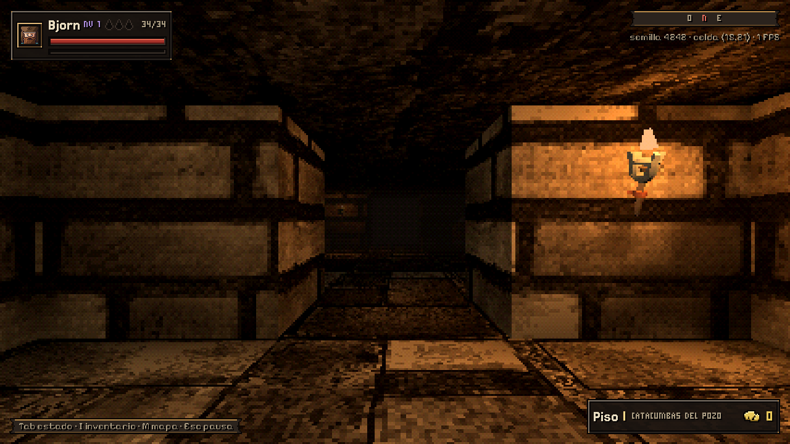
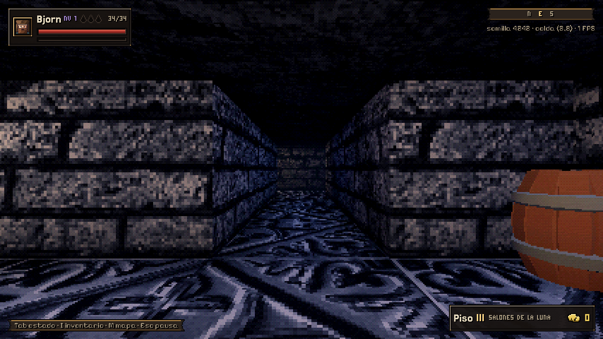
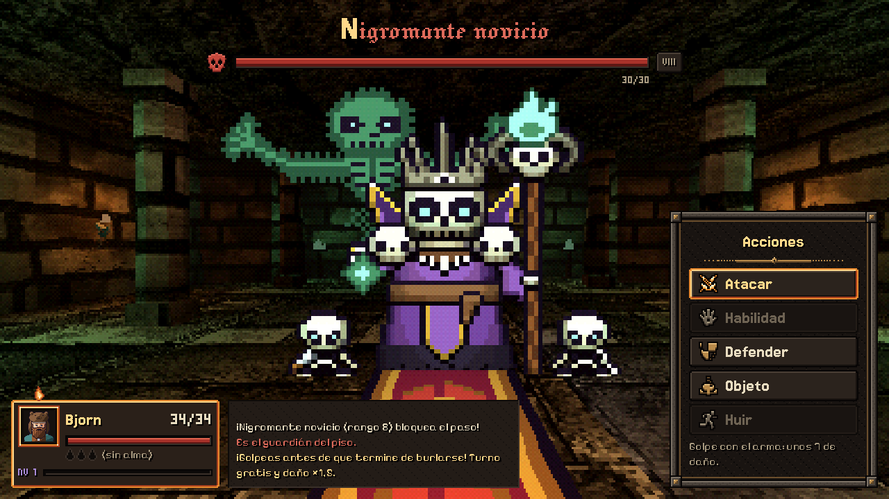
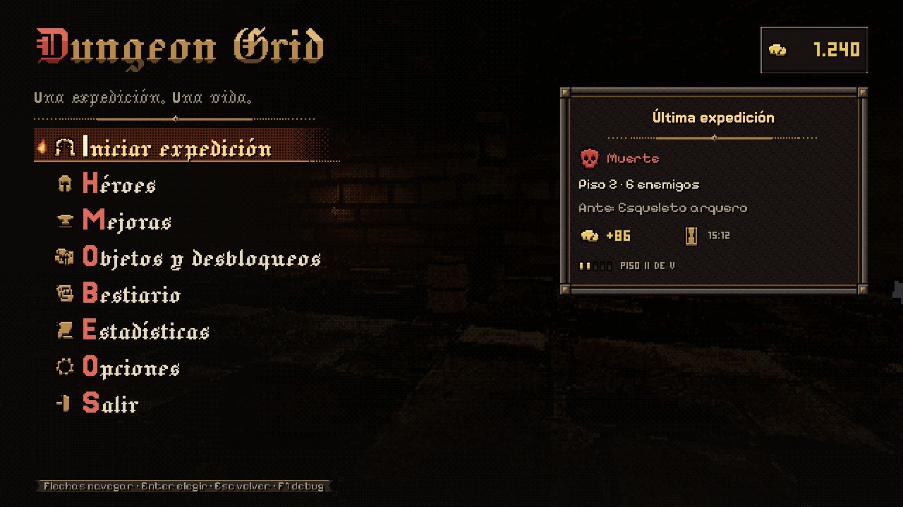
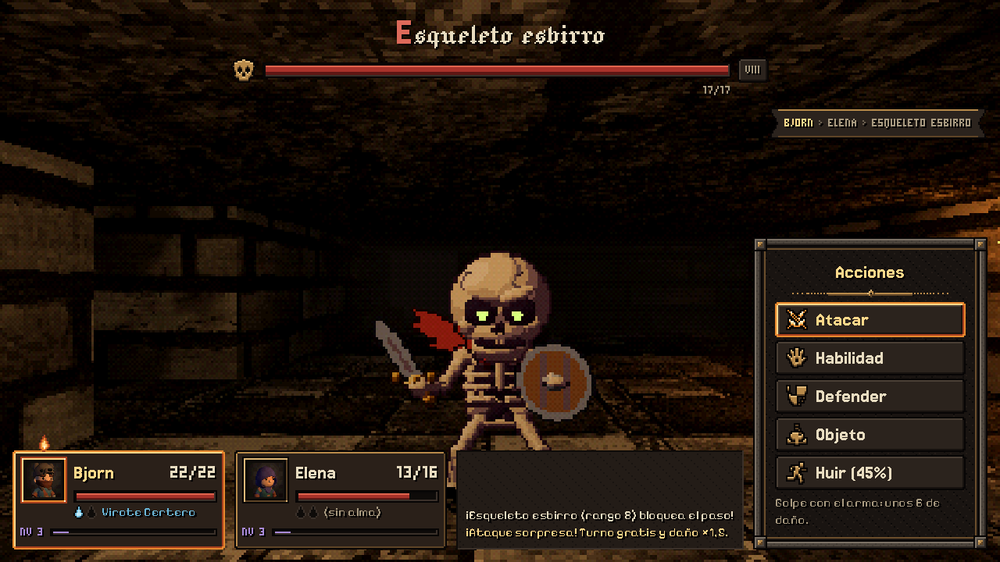
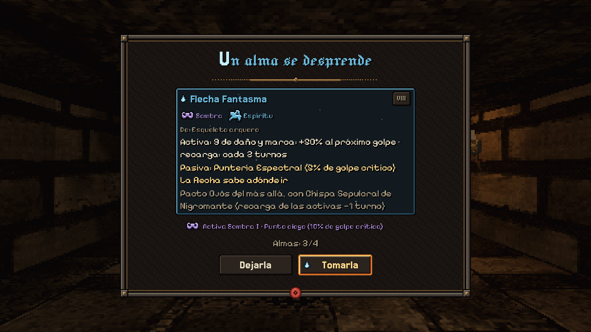
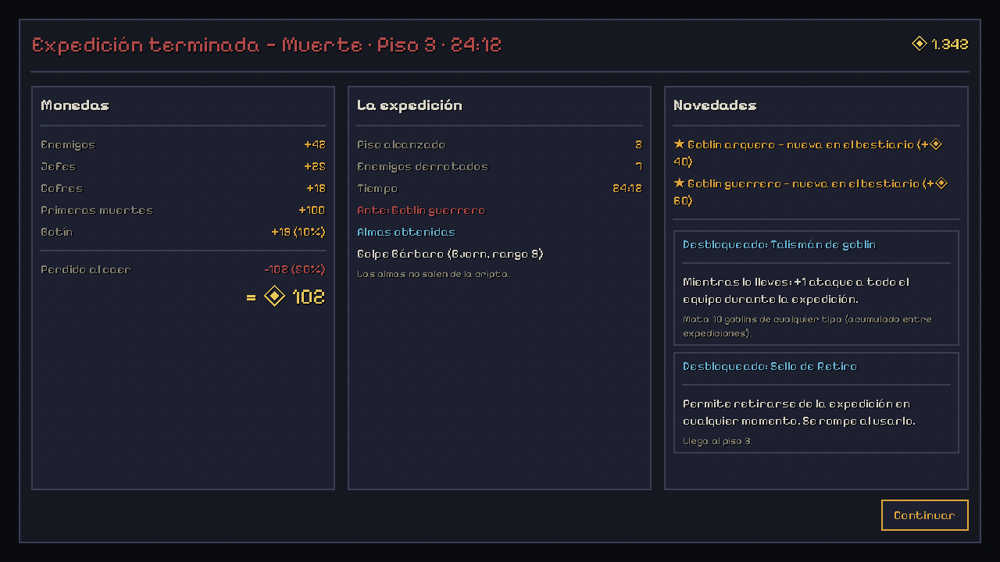
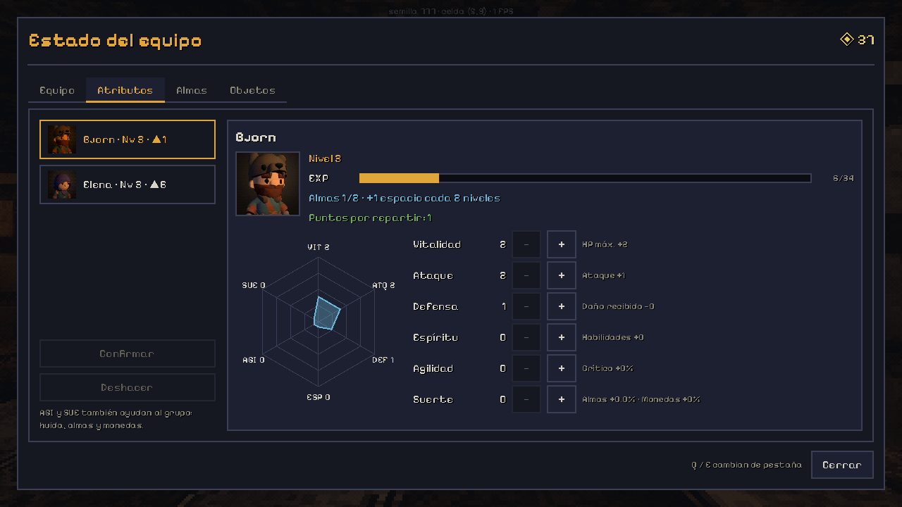
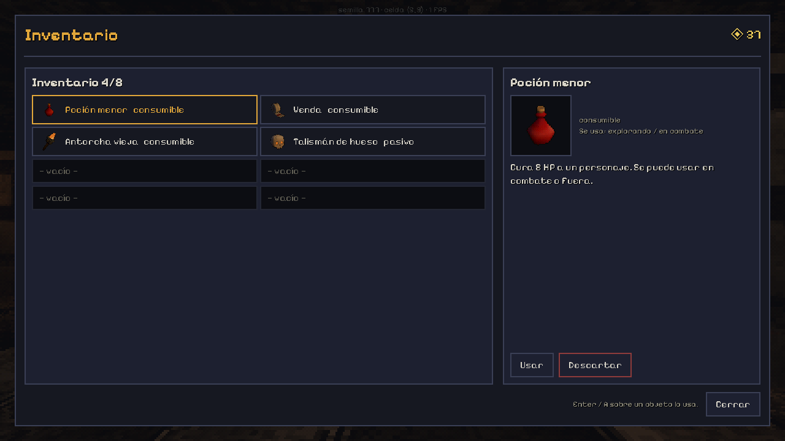
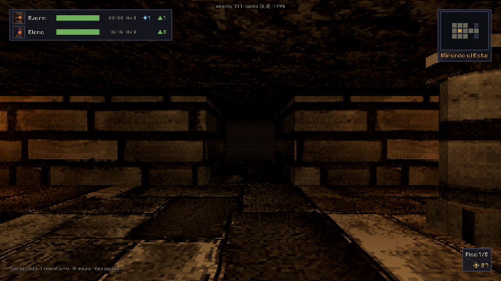

# Dungeon Grid — roguelike en primera persona (Godot 4, estética PS1)

Dungeon crawler por grilla (giros de 90°), combate por turnos con cámara estática y estética PS1 al estilo *Lunacid* / *King's Field*: 240 líneas, trama de color de 15 bits, vértices que tiemblan, texturas que se deforman, niebla de color por bioma y la luz cálida de las antorchas. Una **expedición** = una run con permadeath: bajas pisos generados al azar, subes de nivel, juntas almas y objetos que solo sirven en esa run, y al volver al **Hub** gastas las monedas en mejoras chicas y permanentes.

| Catacumbas del Pozo | Salones de la Luna | Jefe: el nigromante |
|---|---|---|
|  |  |  |



## Cómo jugarlo

1. Abre el proyecto con **Godot 4.7** (`project.godot`). La primera vez tarda un poco: reimporta modelos y texturas.
2. Pulsa **F5**. Arranca en el Hub.

### Controles

| Acción | Teclado | Mando |
|---|---|---|
| Avanzar / retroceder | ↑ ↓ o W S | Cruceta / stick |
| Girar 90° | ← → o A D | Cruceta / stick |
| Atacar a un enemigo | caminar contra él (= **ataque sorpresa**) | — |
| Abrir un cofre | caminar contra él | — |
| Estado del equipo (y **Atributos**) | Tab | Y / △ |
| Inventario (Enter sobre un objeto lo usa) | I | X / □ |
| Mapa del piso | M | Select |
| Pausa | Esc | Start |
| Menús | ↑↓ · Enter · Esc (atrás) · Q/E pestañas | Cruceta · A · B · LB/RB |
| Panel de debug | F1 (solo en el editor / builds de debug) | — |

## Una expedición

- **Pisos 1 a 5**, cada uno más grande (25×25 → 45×45) y con enemigos de rango más fuerte. Rango 10 = más débil, 1 = más fuerte.
- Cada piso es un **bioma** con su paleta, niebla y texturas: Catacumbas del Pozo, Cisterna Anegada, Salones de la Luna, Castillo Carmesí y El Abismo.
- **Enemigos** (esqueletos animados): el **esbirro** y el **ballestero** (básicos), el **guardián** (élite, con hacha y escudo, desde el piso 2) y el **nigromante**, jefe de cada piso, que cambia de nombre, color y tamaño piso a piso. Algunos esqueletos están **dormidos**: parecen un montón de huesos hasta que te acercas.
- Los enemigos **deambulan y te persiguen**. Si chocas tú primero: **ataque sorpresa** (turno gratis y daño ×1,5). Si te alcanzan **por la espalda o un costado: emboscada** (pegan primero ×1,5).
- Cada piso tiene un **jefe** que custodia la salida. Al vencerlo eliges: **bajar**, **retirarte con el botín** o quedarte.
- **Almas**: a veces un enemigo suelta su alma (los jefes siempre). Se revela al pulsar Continuar; recogerla es opcional y eliges quién la lleva (1 activa + pasiva opcional + modificadores). **No salen de la cripta.**
- **Niveles** (solo durante la expedición): cada enemigo da EXP a todo el equipo en pie. Cada nivel da **3 puntos** para repartir en **Estado → Atributos** entre VIT, ATQ, DEF, ESP, AGI y SUE (hexágono con el reparto antes de confirmar), y **cada 2 niveles** un personaje puede llevar **un alma más**. El HUD marca con ▲ quién tiene puntos sin repartir.
- **Objetos**: en cofres y en el suelo. Solo aparecen los ya desbloqueados. Fuera de combate se usan desde el Inventario (las curas solo se ofrecen a los heridos).
- **Morir** conserva el 50% de las monedas; **retirarse** o **ganar**, el 100%.

## Entre expediciones (Hub)

- **Mejoras** con monedas, con tope de 5 niveles: Vitalidad, Fuerza, Botín, Provisiones y Sabiduría.
- **Objetos y desbloqueos**: los objetos nuevos se desbloquean **por condiciones** (llegar al piso 3, destruir 15 esqueletos, huir 3 veces…), nunca con monedas. Se ve el progreso (9/15).
- **Bestiario**: especies vistas, kills y el alma que dan. La primera kill de cada especie da un bonus una sola vez.
- **Estadísticas** y **Opciones**: volumen, pantalla completa, escala de UI 80–150%, **imagen** (Clásica PS1 · Crujiente · Limpia), balanceo de cámara al caminar y controles.

| Combate | Revelación del alma | Resumen de la expedición |
|---|---|---|
|  |  |  |

| Estado → Atributos | Inventario | HUD con nivel y puntos |
|---|---|---|
|  |  |  |

## Valores por defecto que hay que revisar (🟡)

Todos se cambian en `data/balance.json` (y en los otros JSON de `data/`) sin tocar código.

| Decisión abierta | Valor usado |
|---|---|
| Pisos por run | 5, con un jefe por piso (`floors_per_run`, `data/floors.json`) |
| Equipo | 2 personajes, Bjorn y Elena (`party`; admite 1–3) |
| "Impuesto" | No hay sumidero: al morir se conserva el 50% (`coins.coin_keep_on_death`) |
| Bestiario | Persistente; bonus de primera kill = 10 × (11 − rango), una sola vez |
| Almas | Capacidad 1 por personaje (el Amuleto de hueso la sube). Drop: normal 8% × factor de rango, élite 25%, jefe 100% |
| Inventario | 8 objetos; se empieza con 1 Poción menor (`start_items`) |
| Mejoras | Tope 5 niveles; coste = base × nivel. Fuerza +0,6 ATK y Vitalidad +1,6 HP por nivel, redondeado (ver *Balance*) |
| Huir | 50% ± 10% por rango de diferencia con la media del piso; no contra jefes. Si fallas, pierdes el turno |
| Curación entre pisos | 30% del HP máximo al bajar (`heal_between_floors_pct`) |
| Élites | El esqueleto guardián (especie élite, desde el piso 2) y un 5% de variantes élite de los básicos (`enemies.elite_chance`): stats ×1,25, monedas ×2, ojos ámbar |
| Enemigos dormidos | Esbirro 50%, ballestero 30% (`dormant_chance` en `species.json`); se levantan a 2 pasos (`enemies.wake_radius`) |
| Jefes | Stats × 1,5; cada 3 turnos usan una habilidad que golpea a todo el equipo |
| Enemigos por rango | HP 10 + 2,25 × (11 − rango), ATK 1 + 1,1 × (11 − rango), redondeado (`stats_for_rank`; algo más duros que en el prototipo para compensar los niveles) |
| Niveles | Por expedición; tope 10. EXP por kill = 3 + (10 − rango), élite ×1,5, jefe ×4, para cada personaje en pie. Curva `leveling.xp_to_next` (24, 44, 68…). Al subir: 3 puntos, cura 10% y +1 alma cada 2 niveles |
| Atributos (por punto) | VIT +1 HP máx. · ATQ +1 ataque cada 4 · DEF −1 daño recibido cada 4 (un golpe nunca baja de 1) · ESP +1 a las habilidades de alma cada 2 · AGI +1,5% crítico y +1,5% huida (promedio del equipo) · SUE +0,5% almas y +2% monedas (suma del equipo) |
| "Completar una run sin pociones" | Cuenta retirarse o ganar (no morir) |

### Balance

`tools/balance_sim.tscn` juega cientos de runs con las fórmulas reales del juego, con una política simple: atacar, usar la mejor activa, curarse y repartir los puntos de nivel al momento (en ronda entre las 6 estadísticas, o solo VIT/ATQ). Con `-- --set=ruta=valor` se prueban valores sin tocar `balance.json`.

| Configuración | Piso medio | Victorias | Nivel al final |
|---|---|---|---|
| Sin mejoras | 2,5 | 2–5% | 3 |
| Todo al máximo (reparto parejo) | 4,0 | ~22% | 5 |
| Todo al máximo (solo VIT/ATQ) | 4,3 | ~43% | 5 |

Coincide con el objetivo de la guía: sin mejoras se llega al piso 2–3 (lo mismo que antes de los niveles; un 14% muere en el piso 1), y con todo al máximo al 4–5 con riesgo real.

## Herramientas

- **F1 — panel de debug**: monedas, mejoras ±1, desbloquear o bloquear todo, saltar de piso, pelear con el más cercano o con el jefe, curar, ganar el combate, forzar alma o ataque sorpresa, god mode, matar de un golpe, semilla fija, reiniciar guardado, sala de pruebas y galería de UI. Muestra FPS, celda y estado de la run. Registra los eventos en `user://debug.log`.
- **Sala de pruebas**: la sala 15×9 del prototipo (con techo alto) con un enemigo de cada tipo, uno dormido y el jefe. Se abre desde Opciones (en debug) o con F1. No guarda progreso.
- **Galería de UI**: todos los componentes del design system en una pantalla.
- `tools/verify.sh`: verificación completa (import, lint con warnings como errores, arranque, 52 tests unitarios y smoke test de punta a punta, que también usa una poción desde el inventario y reparte puntos en Atributos).
- `tools/screenshot.tscn`: capturas con Xvfb (ver el encabezado del script; `--floor=N` y `--test-room` para revisar biomas y enemigos).
- `tools/enemy_preview.tscn`: todos los enemigos en fila, de frente y de perfil, con líneas de referencia del techo (2 m y 3 m).
- `tools/assets/`: pipeline que adapta los assets libres al estilo (modelos de enemigos y texturas de cada bioma). Ver su `README.md`.
- `tools/portraits/`: hornea los retratos de héroes (96×96) y objetos (64×64) como render 3D con el filtro PS1 del juego. Ver su `README.md`.

## Estructura

```
autoload/   EventBus, DataRegistry, MetaState, SaveSystem, GameState, Controls, SceneRouter, DebugTools
data/       species, souls, items, unlocks, upgrades, floors (con los biomas), balance, texts (todo en JSON)
assets/     enemies/ (esqueletos adaptados), textures/<bioma>/ (paredes, pisos, techos), portraits/ (héroes y objetos), fuentes, props
scenes/     Boot, Hub, Run, RunSummary, ui/UIGallery
scripts/    run/ (RunController, FloorGenerator, FloorBuilder, reglas, recompensas, desbloqueos)
            combat/ (CombatManager, pasivas) · world/ (GridPlayer, EnemyVisual, RetroView, FlickerLight)
            ui/ (theme, componentes, pantallas, HUD)
shaders/    psx_viewport_dither (trama PS1 dentro del SubViewport)
ui/         theme_main.tres (generado por scripts/ui/theme_builder.gd)
tests/      TestRunner (unitarios) y SmokeTest
tools/      verify.sh, lint, build_theme, balance_sim, screenshot, enemy_preview, assets/ (pipeline de assets), portraits/
docs/       GUIA_CLAUDE_CODE.md, ESTADO_TECNICO_PROTOTIPO.md, capturas/
```

## Licencias

- Fuentes: Pixelify Sans, Noto Sans Symbols y Noto Sans Symbols 2 (SIL OFL 1.1, ver `assets/fonts/`). Las Noto están recortadas y con las métricas ajustadas.
- **Enemigos**: KayKit Character Pack: Skeletons, de Kay Lousberg (CC0, `assets/enemies/LICENSE_KayKit_Skeletons.txt`), adaptados con `tools/assets`.
- **Antorchas**: KayKit Dungeon Remastered, de Kay Lousberg (CC0, `addons/kaykit_dungeon_remastered/Assets/LICENSE.txt`).
- **Retratos**: héroes de KayKit Character Pack: Adventurers (Barbarian y Rogue con capucha, recoloreados) y objetos de KayKit Dungeon Remastered y Halloween Bits, más algunos hechos con primitivas; todo de Kay Lousberg, CC0 (`assets/portraits/LICENSE_KayKit_*.txt`). Detalle por retrato en `tools/portraits/README.md`.
- **Texturas de los biomas**: WRAD Textures, de wriks (CC0, `assets/textures/LICENSE_WRAD.txt`), reducidas y recoloreadas con `tools/assets/make_textures.py`.
- Pack PSX de cajas/barriles (Games by McSteeg): `assets/psx_boxes_barrels/Licence.txt`. Permite usarlo en juegos, **pero prohíbe redistribuirlo**: si el repo es público, conviene sacarlo del repo o pasar a props CC0 antes de publicar.
- PSX Visuals y LevelBlock: ver sus carpetas en `addons/`.
- **El pack de goblins no trae licencia**: esas especies quedaron inactivas (`"activo": false`) y no aparecen en el juego.

## Pendiente / diferido

- Diferido a propósito, sin pedido no se implementa: razas, árbol de habilidades, crafting, eventos mensuales. (Niveles/EXP ya están, por expedición.)
- `addons/dungeon_crawler_3d` quedó sin usar: el generador propio produce la grilla que ya consume el juego (ver `docs/ESTADO_TECNICO_PROTOTIPO.md`).
- Gothic Furniture sigue sin integrar (los `.fbx` necesitan materiales asignados a mano).
- Los esqueletos de KayKit tienen proporciones estilizadas ("chibi"): se achicaron cabeza y manos, pero un modelo de proporciones más realistas (CC0) encajaría mejor con Lunacid.
- Sonidos: hay blips generados por código; faltan sonidos reales.
