# Dungeon Grid — roguelike en primera persona (Godot 4, estética PS1)

Dungeon crawler por grilla (giros de 90°), combate por turnos con cámara estática y estética PS1 al estilo *Lunacid* / *King's Field*: 240 líneas, trama de color de 15 bits, vértices que tiemblan, texturas que se deforman, niebla de color por bioma y la luz cálida de las antorchas. Una **expedición** = una run con permadeath: bajas pisos generados al azar, subes de nivel, juntas almas y objetos que solo sirven en esa run, y al volver al **Hub** gastas las monedas en mejoras chicas y permanentes.

| Catacumbas del Pozo | Salones de la Luna | Jefe: el nigromante |
|---|---|---|
|  |  |  |

| Enemigos en pixel art (Cisterna Anegada) | El esbirro: frente, perfil, espalda, tajo, escudazo, golpe y dormido |
|---|---|
| 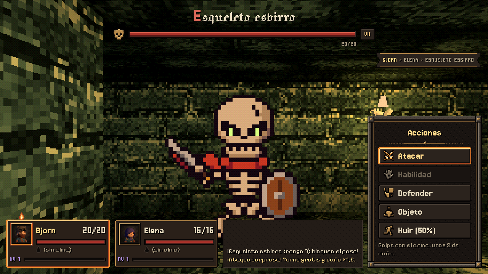 |  |


## Cómo jugarlo

1. Abre el proyecto con **Godot 4.7** (`project.godot`). La primera vez tarda un poco: reimporta modelos y texturas.
2. Pulsa **F5**. Arranca en el Hub.

### Controles

| Acción | Teclado | Mando |
|---|---|---|
| Avanzar / retroceder | ↑ ↓ o W S | Cruceta / stick |
| Girar 90° | ← → o A D | Cruceta / stick |
| Atacar a un enemigo | caminar contra él (= **ataque sorpresa**) | — |
| Abrir un cofre | caminar contra él | — |
| Estado del héroe (y **Atributos**, **Almas**) | Tab | Y / △ |
| Inventario (Enter sobre un objeto lo usa) | I | X / □ |
| Mapa (bajas la mirada y abres el pergamino; M o Esc lo guarda) | M | Select |
| Pausa | Esc | Start |
| Menús | ↑↓ · Enter · Esc (atrás) · Q/E pestañas | Cruceta · A · B · LB/RB |
| Panel de debug | F1 (solo en el editor / builds de debug) | — |

## Una expedición

- **Pisos 1 a 5**, cada uno más grande (25×25 → 45×45) y con enemigos de rango más fuerte. Rango 10 = más débil, 1 = más fuerte.
- Cada piso es un **bioma** con su paleta, niebla y texturas: Catacumbas del Pozo, Cisterna Anegada, Salones de la Luna, Castillo Carmesí y El Abismo.
- **Enemigos** en **pixel art grueso** dentro del mundo 3D (estilo Dragon Quest HD-2D): monstruos caricaturescos de calavera enorme, de píxeles gordos, pocos colores y contorno negro (contraste duro con el entorno 3D), con luz con volumen (mapa de normales, sombreado en bandas) y animaciones con anticipación y compresión; miran a la cámara, con vistas de frente, perfil y espalda, y llevan la niebla del entorno. Las hojas se generan por código (`tools/sprites/draw_*.py`, ver su README) y el arte definitivo puede reemplazarlas con el mismo formato; en Opciones → Enemigos se puede volver a los modelos 3D. Los esqueletos: el **esbirro** y el **arquero** (básicos), el **guardián** (élite, con casco de cuernos, hacha y escudo, desde el piso 2) y el **nigromante**, jefe de cada piso, que cambia de nombre, epíteto, color y tamaño piso a piso y trae un espectro y dos esqueletitos. Algunos esqueletos están **dormidos**: parecen un montón de huesos hasta que te acercas.
- Los enemigos **deambulan y te persiguen**. Si chocas tú primero: **ataque sorpresa** (turno gratis y daño ×1,5). Si te alcanzan **por la espalda o un costado: emboscada** (pegan primero ×1,5).
- Cada piso tiene un **jefe** que custodia la salida, en su **sala hecha a mano** (la misma en todos los pisos, con las texturas del bioma; el generador la apoya contra un borde y la gira para que la puerta mire al resto del piso): una nave simétrica con alfombra, columnas, braseros y antorchas, el jefe dormido al fondo (un montón de túnica sobre un círculo de runas) y la salida en un nicho detrás. Se entra por una **puerta cerrada** que se abre chocándola; al pasar, la puerta se cierra de un portazo detrás tuyo y empieza la **presentación**, todo sobre el eje de la sala: los braseros se encienden de a pares con el color del jefe, se enciende el círculo, el jefe se levanta, aparece su cartel (nombre y epíteto), se burla y viene por la alfombra hasta ti; el combate entra con su barra de vida que se llena (Enter o Esc aceleran la presentación). Al vencerlo se abre la puerta y eliges: **bajar**, **retirarte con el botín** o quedarte.

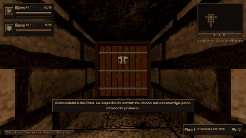
- **Un solo héroe**: la expedición es uno contra uno; el build sale de las almas que juntes.
- **Almas** (la mecánica principal): a veces un enemigo suelta su alma. Cada especie tiene **varias almas distintas** (el esbirro tres, el arquero cuatro, el guardián tres) y suelta una al azar; cada enemigo vencido sin soltar alma hace más probable la siguiente (**protección contra la mala suerte**, se ve en Estado → Almas). **Los jefes dejan elegir 1 de 3**: su alma, otra de jefe al azar y una de las especies del piso, cada una con lo que activaría. Se revela al pulsar Continuar, con lo que activaría en tu build; tomarla es opcional y, sin lugar, puedes cambiarla por una que lleves (cada opción dice qué ganas y qué pierdes). Se empieza con **3 espacios** y se gana **uno cada 2 niveles**. **No salen de la cripta.** Cada alma trae:
  - una **activa con efecto y recarga**: golpe fuerte, varios golpes, sangrado, aturdir, drenar vida, escudo, marcar (el próximo golpe pega más), debilitar o ejecutar (doble daño si al enemigo le queda poca vida). Su poder sale de tu ataque + el rango del monstruo que la soltó + ESP. Ninguna recarga baja de 2 turnos, y los efectos que se acumulan (sangrado, robo de vida, crítico, escudo, marca, debilitar, aturdir) tienen **tope** (`balance.json → combat.topes`); a un enemigo aturdido le cuesta dos acciones suyas volver a aturdirse, y a un jefe se lo aturde un turno como mucho;
  - una **pasiva** opcional y **modificadores** de estadísticas;
  - una o dos **afinidades**: Hueso, Sangre, Sombra, Espíritu, Acero y Fortuna. Juntar 2 y 4 almas de la misma afinidad (Fortuna: 2 y 3) activa sus **niveles** (p. ej. Sangre I: tus ataques sangran; Sombra II: críticos ×2,5 que marcan; Hueso II: una vez por combate sobrevives con 1 HP);
  - **pactos**: dos almas concretas juntas dan un efecto propio (Hemorragia, Lluvia de acero, Muralla de huesos, Verdugo…). Cada tarjeta dice con qué alma pacta.
  Todo está en **Estado → Almas** (tarjetas con las cifras reales y las sinergias activas o a medias) y en `data/souls.json` y `data/sinergias.json`.
  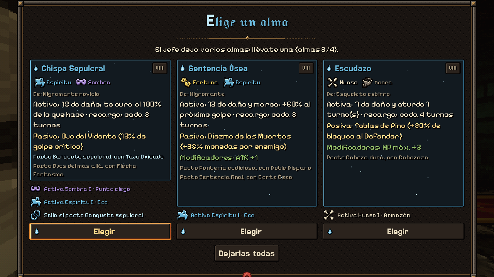
- **Combate**: Atacar, **Habilidad** (las activas listas, con su daño y recarga), Defender, Objeto y Huir. El enemigo muestra sus estados bajo la barra (sangrado, aturdido, marca, debilitado) y el jefe **avisa** cuando prepara su golpe fuerte (cada 3 turnos): es el momento de Defender.
  Cada golpe **se siente**: números que saltan (los críticos enormes, con «¡Crítico!», destello y un instante de pausa), astillas de hueso, la cámara que se sacude y el enemigo que retrocede, los golpes de una ráfaga uno por uno y su total, el cartel con el nombre de la activa en el color de su afinidad y un **aviso cada vez que salta una sinergia** («Pacto: Hemorragia», «Sangre · Herida abierta»). Recibir daño tiñe los bordes de rojo, y con poca vida late. Al vencer, el enemigo estalla en astillas, su alma sube y aparece «¡Derrotado!». Opciones → «Destellos y sacudones» apaga los destellos, la viñeta y el sacudón.
- **Niveles** (solo durante la expedición): cada enemigo da EXP. Cada nivel da **3 puntos** para repartir en **Estado → Atributos** entre VIT, ATQ, DEF, ESP, AGI y SUE (hexágono con el reparto antes de confirmar), y **cada 2 niveles** un espacio de alma más. El HUD marca con ▲ si hay puntos sin repartir.
- **Mapa de mano**: no hay minimapa. Con **M** el héroe baja la mirada y levanta un **pergamino** entre dos varas, dibujado a tinta con lo que ya recorriste (los muros, los cofres, los enemigos que viste, la puerta del jefe y la salida; tú, una flecha roja). Con el mapa abierto no se camina; M o Esc lo guardan.

  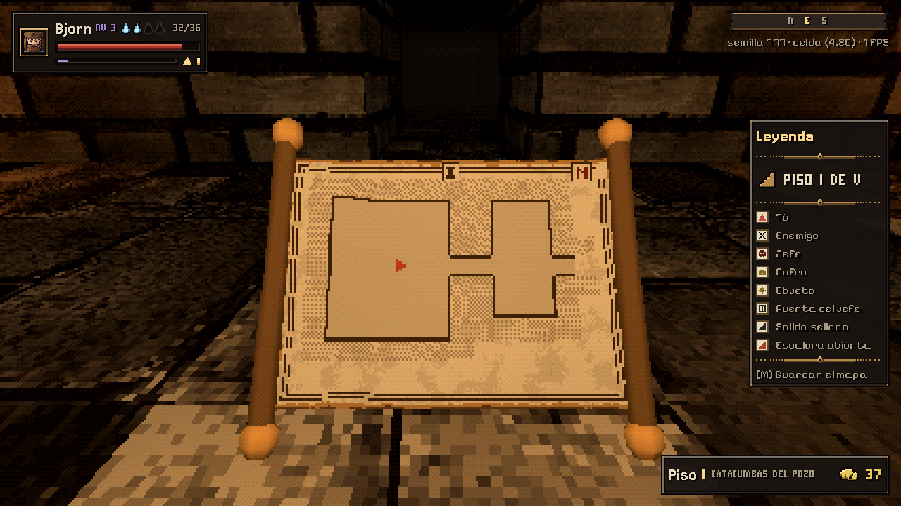
- **Cofres** en **pixel art** como los enemigos, con una luz dorada propia y destellos que los hacen resaltar en el pasillo; al abrirlos se sacuden, se levanta la tapa y sale un golpe de luz (`tools/sprites/draw_cofre.py`).

  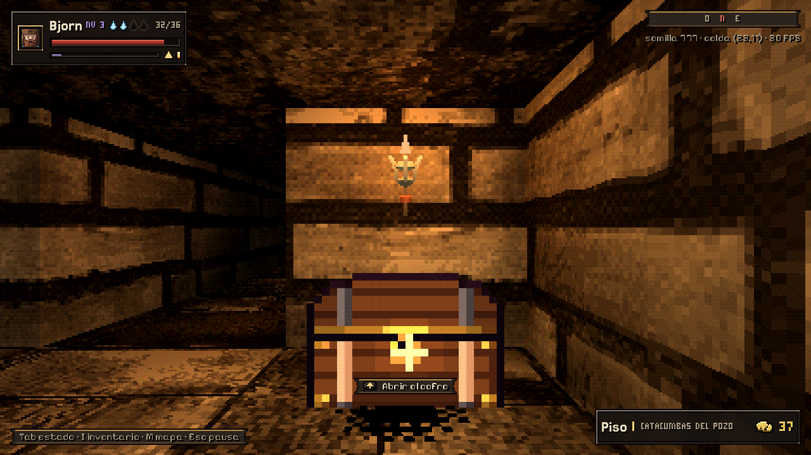 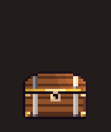
- **Objetos**: en cofres y en el suelo. Solo aparecen los ya desbloqueados. Fuera de combate se usan desde el Inventario (las curas no se gastan con el HP completo).
- **Morir** conserva el 50% de las monedas; **retirarse** o **ganar**, el 100%.

## Héroe

En el Hub, **Héroe** permite cambiar el **nombre** y la **apariencia** del personaje: cara, piel, ojos y su color, boca, marcas (cicatriz, pintura de guerra, pecas), pelo y su color, barba, tocado (capucha, cabeza de oso, cinta, casco) y su color, y ropa (túnica, coraza de cuero, armadura, harapos) y su color, más **Al azar** y **Como al principio**. Es solo apariencia (no cambia estadísticas) y se guarda entre expediciones. Los **retratos** son **pixel art grueso**, como los enemigos, armados por capas en el juego (48×48, a escala entera o recortados a la cara en los huecos chicos: HUD, combate, Estado).

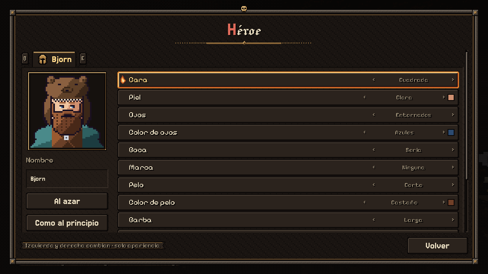

## Entre expediciones (Hub)

- **Mejoras** con monedas, con tope de 5 niveles: Vitalidad, Fuerza, Botín, Provisiones y Sabiduría.
- **Objetos y desbloqueos**: los objetos nuevos se desbloquean **por condiciones** (llegar al piso 3, destruir 15 esqueletos, huir 3 veces…), nunca con monedas. Se ve el progreso (9/15).
- **Bestiario**: especies vistas, kills y las almas que dan (al absorber una de esa especie se ven todas). La primera kill de cada especie da un bonus una sola vez.
- **Estadísticas** y **Opciones**: volumen, pantalla completa, escala de la interfaz (Compacta · Normal · Grande, siempre con el píxel parejo), **imagen** (Clásica PS1 · Crujiente · Limpia), balanceo de cámara al caminar, controles y créditos.

## La interfaz: «Grimorio de la Cripta»

Menús de hierro remachado y vitela oscura, títulos góticos con capitular roja, cursor de llama y foco de brasa. El azul frío es solo de las **almas**, el rojo del HP y la amatista de la EXP. Todo es pixel art (×2, sin suavizado) generado por código desde una paleta en `data/ui_palette.json` (`tools/ui/`), con íconos de game-icons.net, fuentes góticas y pixel de Google Fonts y sonidos de Kenney.

| Combate | Un alma se desprende | Crónica de la expedición |
|---|---|---|
|  |  |  |

| Estado → Atributos | Estado → Almas (afinidades y pactos) | Inventario |
|---|---|---|
|  | 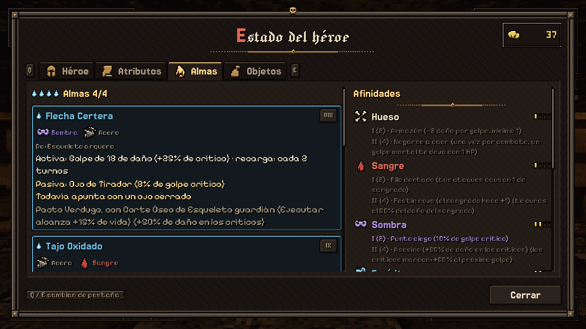 |  |

| Mejoras | Bestiario | Pausa |
|---|---|---|
| 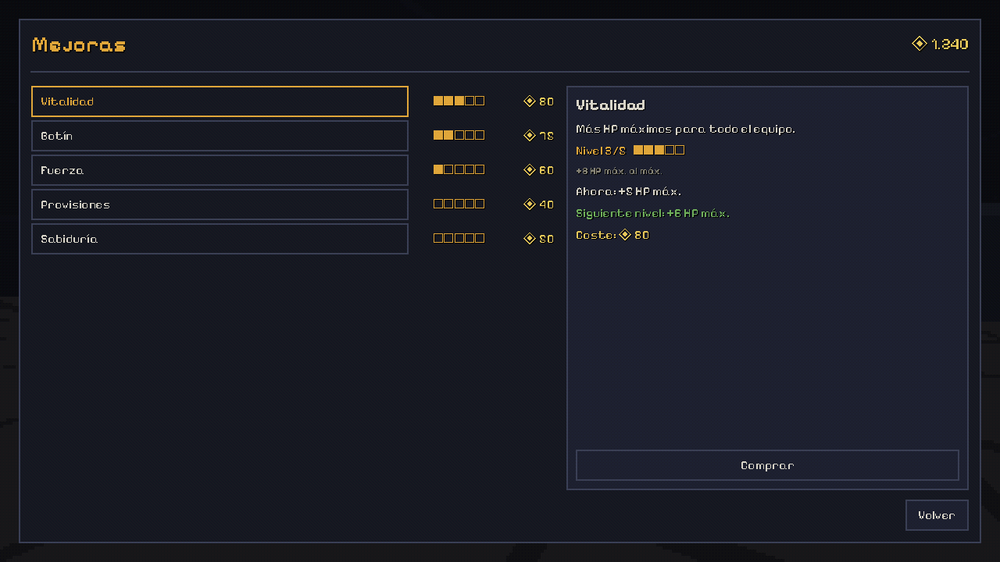 | 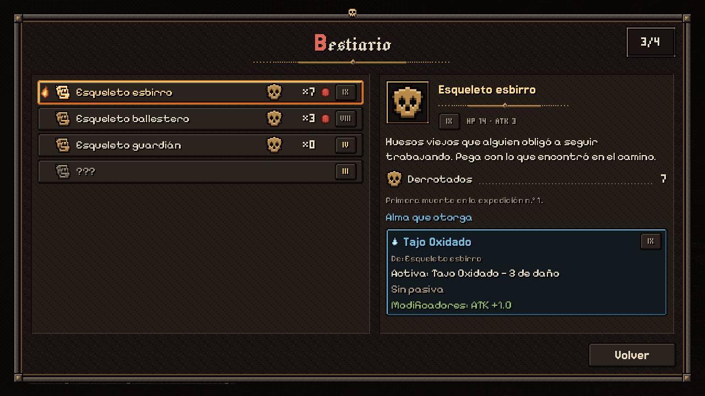 | 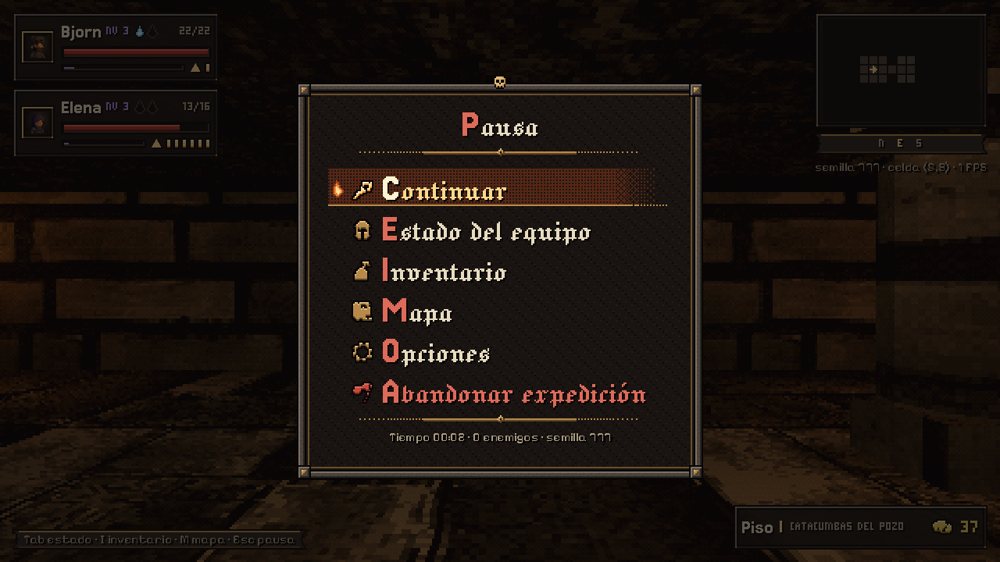 |

| HUD | Mapa | Opciones |
|---|---|---|
|  |  | 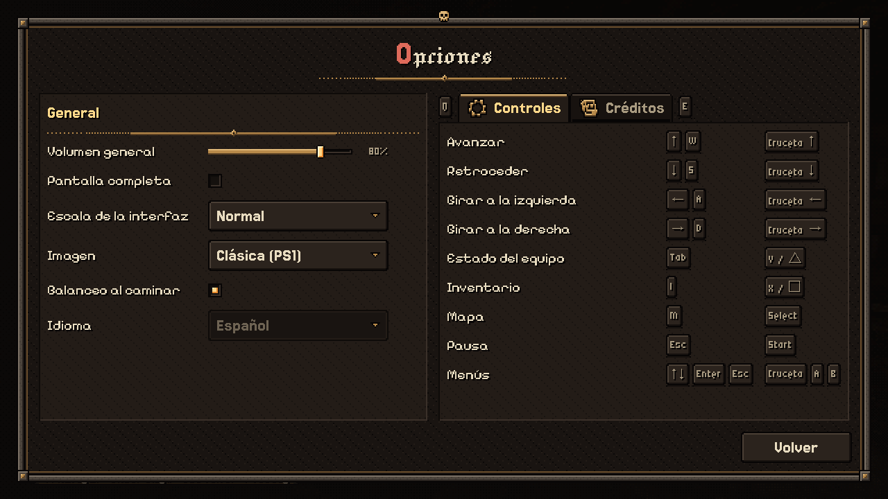 |

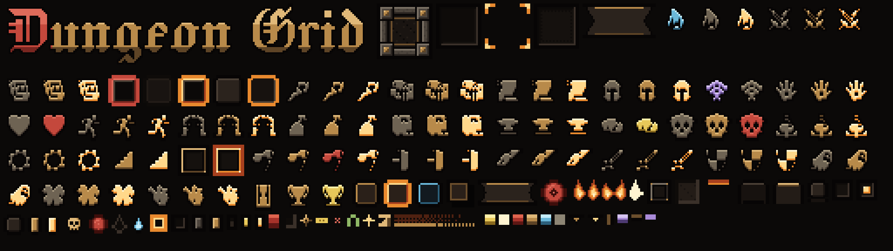

## Valores por defecto que hay que revisar (🟡)

Todos se cambian en `data/balance.json` (y en los otros JSON de `data/`) sin tocar código.

| Decisión abierta | Valor usado |
|---|---|
| Pisos por run | 5, con un jefe por piso (`floors_per_run`, `data/floors.json`) |
| Equipo | Un héroe, Bjorn: 34 HP, 7 ATK (`party`, con un solo personaje) |
| "Impuesto" | No hay sumidero: al morir se conserva el 50% (`coins.coin_keep_on_death`) |
| Bestiario | Persistente; bonus de primera kill = 10 × (11 − rango), una sola vez |
| Almas | 3 espacios al empezar, +1 cada 2 niveles (y el Amuleto de hueso). Drop: normal 20% × factor de rango, élite 60%, jefe 100% (elegir 1 de 3, `almas.opciones_jefe`); +5% por cada enemigo seguido sin alma (`soul_drop.pity_per_kill`). Poder extra por rango del alma: 0,35 × (11 − rango) (`almas.poder_por_rango`); recarga mínima 2 (`almas.recarga_minima`). Afinidades y pactos en `data/sinergias.json` |
| Inventario | 8 objetos; se empieza con 1 Poción menor (`start_items`) |
| Mejoras | Tope 5 niveles; coste = base × nivel. Fuerza +0,4 ATK y Vitalidad +1,6 HP por nivel, redondeado (ver *Balance*) |
| Huir | 50% ± 10% por rango de diferencia con la media del piso; no contra jefes. Si fallas, pierdes el turno |
| Curación entre pisos | 30% del HP máximo al bajar (`heal_between_floors_pct`) |
| Élites | El esqueleto guardián (especie élite, desde el piso 2) y un 5% de variantes élite de los básicos (`enemies.elite_chance`): stats ×1,25, monedas ×2, ojos ámbar |
| Enemigos dormidos | Esbirro 50%, arquero 30% (`dormant_chance` en `species.json`); se levantan a 2 pasos (`enemies.wake_radius`) |
| Jefes | Stats × 1,5; cada 3 turnos, un golpe fuerte (×1,6) que anuncian el turno antes (Defender lo frena a la mitad). No deambulan: duermen en su sala hasta la presentación, y después golpeas primero (turno gratis ×1,5, como un ataque sorpresa). Rangos por piso: 8, 6, 4, 2, 1 |
| Enemigos por rango | HP 5,25 + 4,75 × (11 − rango), ATK −0,25 + 1,9 × (11 − rango), redondeado (`stats_for_rank`): en el piso 1 casi como antes, mucho más duros en los profundos (las almas y sus sinergias crecen rápido) |
| Niveles | Por expedición; tope 10. EXP por kill = 3 + (10 − rango), élite ×1,5, jefe ×4, para cada personaje en pie. Curva `leveling.xp_to_next` (24, 44, 76, 120…: los primeros niveles llegan rápido y los altos cuestan). Al subir: 3 puntos, cura 10% y +1 espacio de alma en los niveles 3, 5, 7 y 9 |
| Atributos (por punto) | VIT +1 HP máx. · ATQ +1 ataque cada 4 · DEF −1 daño recibido cada 4 (un golpe nunca baja de 1) · ESP +1 a las habilidades de alma cada 2 · AGI +1,5% crítico y +1,5% huida · SUE +0,5% almas y +2% monedas |
| "Completar una run sin pociones" | Cuenta retirarse o ganar (no morir) |

### Balance

`tools/balance_sim.tscn` juega cientos de runs con las reglas reales del juego (el mismo `CombatCore` que el combate y las mismas funciones de almas de `GameState`), con una política simple: curarse con pociones, defenderse cuando el jefe carga su golpe, usar la activa lista que más rinde (contando la marca puesta y si Ejecutar ya alcanza) o atacar, tomar las almas y cambiarlas si mejora el conjunto (sinergias y poder; del jefe, la que deja el mejor conjunto), y repartir los puntos de nivel al momento (en ronda entre las 6 estadísticas, o solo VIT/ATQ). Con `-- --set=ruta=valor` se prueban valores sin tocar `balance.json`.

| Configuración | Piso medio | Victorias | Al final | Turnos atacando |
|---|---|---|---|---|
| Sin mejoras | 2,8–3,0 | 3–8% | nivel 3,4 · 3,1 almas · 2,4 niveles de afinidad · 1,3 pactos | ~24% |
| Todo al máximo | 4,2 | 28–30% | nivel 4,9 · 4,5 almas · 3,9 niveles · 2,3 pactos | ~14% |
| Máximo + todo desbloqueado | 4,2–4,4 | 27–36% | nivel 5 · 4,6 almas · 4 niveles · 2,4 pactos | ~14% |

Coincide con el objetivo de la guía: sin mejoras se llega al piso 2–3 y con todo al máximo al 4–5 con riesgo real (las muertes se reparten entre los pisos 3, 4 y 5).

**Builds** (un promedio no detecta un build roto):
- Después del resumen, para «sin mejoras» y «al máximo»: de las runs que llegan al piso 3, victorias y piso medio según los pactos y la afinidad dominante que llevaban al empezarlo, y cuánto se ofrece, se toma y se lleva cada alma.
- `-- --builds`: **builds forzados** (el héroe empieza con esas almas y no cambia): sin almas, cada pacto solo y cada afinidad con las almas de su último nivel; `-- --build=a,b,c` prueba uno concreto.
- `-- --check` (lo corre `tools/verify.sh`): falla si algún build forzado gana más del 60% sin mejoras, si el piso medio sin mejoras sale de 2,2–3,6 o si «atacar» baja del 15% de los turnos.

Con esto salió (27-oct-2026) que Hueso ×4 (Escudazo + Cabezazo con Cabeza dura y escudos) ganaba el **95%** sin mejoras aturdiendo al enemigo casi todos los turnos: ahora el aturdido resiste dos acciones suyas y a un jefe se lo aturde un turno. Hoy el build forzado más fuerte es Sangre ×4 (piso 4,4 sin mejoras, 4–6% de victorias) y el más flojo, Fortuna ×3 (piso 2, una afinidad de economía).

## Herramientas

- **F1 — panel de debug**: monedas, mejoras ±1, desbloquear o bloquear todo, saltar de piso, pelear con el más cercano o con el jefe, curar, ganar el combate, forzar alma o ataque sorpresa, god mode, matar de un golpe, semilla fija, reiniciar guardado, sala de pruebas y galería de UI. Muestra FPS, celda y estado de la run. Registra los eventos en `user://debug.log`.
- **Sala de pruebas**: la sala 15×9 del prototipo (con techo alto) con un enemigo de cada tipo, uno dormido y el jefe. Se abre desde Opciones (en debug) o con F1. No guarda progreso.
- **Galería de UI**: todos los componentes del design system en una pantalla (íconos, barras, rangos, nichos, avisos, diálogos, pestañas).
- `tools/ui/`: generador del kit pixel de la UI (paleta → atlas + manifiesto → Theme). Ver su `README.md`.
- `tools/verify.sh`: verificación completa (import, lint con warnings como errores, arranque, tests unitarios y smoke test de punta a punta, que también usa una poción desde el inventario y reparte puntos en Atributos).
- `tools/screenshot.tscn`: capturas con Xvfb (ver el encabezado del script; `--floor=N` y `--test-room` para revisar biomas y enemigos, `--screen=Clase` y `--tab=N` para las pantallas).
- `tools/enemy_preview.tscn`: todos los enemigos en fila, de frente y de perfil, con líneas de referencia del techo (2 m y 3 m).
- `tools/assets/`: pipeline que adapta los assets libres al estilo (modelos de enemigos y texturas de cada bioma). Ver su `README.md`.
- `tools/sprites/`: hojas de pixel art de los enemigos (guía de estilo, formato para el arte definitivo, generador de las de prueba y vista previa). Ver su `README.md`.
- `tools/portraits/`: las piezas de los retratos de héroes en pixel art (`draw_hero_parts.py`) y el horneado de los de objetos (64×64, render 3D con el filtro PS1 del juego). Ver su `README.md`.
- `tools/audio/make_boss_sfx.py`: sintetiza los sonidos de la sala del jefe (portazo, brasero, entrada).

## Estructura

```
autoload/   EventBus, DataRegistry, MetaState, SaveSystem, GameState, Controls, SceneRouter, DebugTools
data/       species, souls, items, unlocks, upgrades, floors (con los biomas), balance, texts (todo en JSON)
assets/     enemies/ (esqueletos adaptados), sprites/enemies/ (hojas de pixel art), textures/<bioma>/ (paredes, pisos, techos), portraits/ (héroes y objetos), fuentes, props
scenes/     Boot, Hub, Run, RunSummary, ui/UIGallery
scripts/    run/ (RunController, FloorGenerator, FloorBuilder, reglas, recompensas, desbloqueos)
            combat/ (CombatCore, CombatManager, CombatFx, almas) · world/ (GridPlayer, EnemySprite/EnemyVisual, RetroView, FlickerLight, FieldMap + MapParchment)
            ui/ (theme, componentes, pantallas, HUD)
shaders/    psx_viewport_dither (trama PS1 dentro del SubViewport)
ui/         theme_main.tres (generado por scripts/ui/theme_builder.gd), kit/ (atlas + manifiesto de tools/ui), shaders/
tests/      TestRunner (unitarios) y SmokeTest
tools/      verify.sh, lint, build_theme, balance_sim, screenshot, enemy_preview, assets/ (pipeline de assets), portraits/, ui/ (kit de la UI)
docs/       GUIA_CLAUDE_CODE.md, ESTADO_TECNICO_PROTOTIPO.md, capturas/
```

## Licencias

- **Fuentes** (SIL OFL 1.1, ver `assets/fonts/`): Jacquard 12 y 24, Jacquarda Bastarda 9, Jersey 15 y Micro 5 (The Soft Type Project Authors), Pixelify Sans (The Pixelify Sans Project Authors) y Noto Sans Symbols 1 y 2 (recortadas y con las métricas ajustadas).
- **Íconos**: game-icons.net — *Icons made by Lorc, Delapouite, Skoll y Sbed*, [CC BY 3.0](https://creativecommons.org/licenses/by/3.0/). Rasterizados a 16 px y recoloreados. Lista y licencia en `tools/ui/`. El crédito también está en Opciones → Créditos.
- **Sonidos de la UI**: Kenney (kenney.nl), UI Audio, RPG Audio e Interface Sounds, CC0 (`assets/audio/ui/`).
- **Enemigos**: esqueleto "Skeleton - Realistic" de Paul Kotelevets (Blender Human Base Meshes, CC0), animado con Universal Animation Library 1 y 2 de Quaternius (CC0); la túnica del nigromante sale de Modular Character Outfits - Fantasy de Quaternius (CC0). Las armas son de KayKit Character Pack: Skeletons, de Kay Lousberg (CC0). Licencias, repos y commits exactos en `assets/enemies/LICENSE_*.txt`; el armado, en `tools/assets/` (Blender por `bpy` + Node).
- **Antorchas, cajas y barriles**: KayKit Dungeon Remastered, de Kay Lousberg (CC0, `addons/kaykit_dungeon_remastered/Assets/LICENSE.txt`). El cofre es propio (pixel art por código, `tools/sprites/draw_cofre.py`).
- **Retratos**: los de héroes son propios (pixel art por código, `tools/portraits/draw_hero_parts.py`); los de objetos, de KayKit Dungeon Remastered y Halloween Bits, más algunos hechos con primitivas; todo de Kay Lousberg, CC0 (`assets/portraits/LICENSE_KayKit_*.txt`). Detalle por retrato en `tools/portraits/README.md`.
- **Texturas de los biomas**: WRAD Textures, de wriks (CC0, `assets/textures/LICENSE_WRAD.txt`), reducidas y recoloreadas con `tools/assets/make_textures.py`.
- PSX Visuals y LevelBlock: ver sus carpetas en `addons/`.
- Sacados del repo (27-oct-2026) por licencia: el pack de goblins (sin licencia), Gothic Furniture (texturas de Textures.com, que limitan redistribuirlas) y el pack PSX de cajas y barriles de Games by McSteeg (permite usarlo en juegos pero prohíbe redistribuirlo). Las cajas y barriles se reemplazaron por los de KayKit (CC0). Siguen en el historial de git: si el repo se hace público, conviene limpiarlo también.

## Pendiente / diferido

- Diferido a propósito, sin pedido no se implementa: razas, árbol de habilidades, crafting, eventos mensuales. (Niveles/EXP ya están, por expedición.)
- `addons/dungeon_crawler_3d` quedó sin usar: el generador propio produce la grilla que ya consume el juego (ver `docs/ESTADO_TECNICO_PROTOTIPO.md`).
- Sonidos: hay blips generados por código; faltan sonidos reales.
