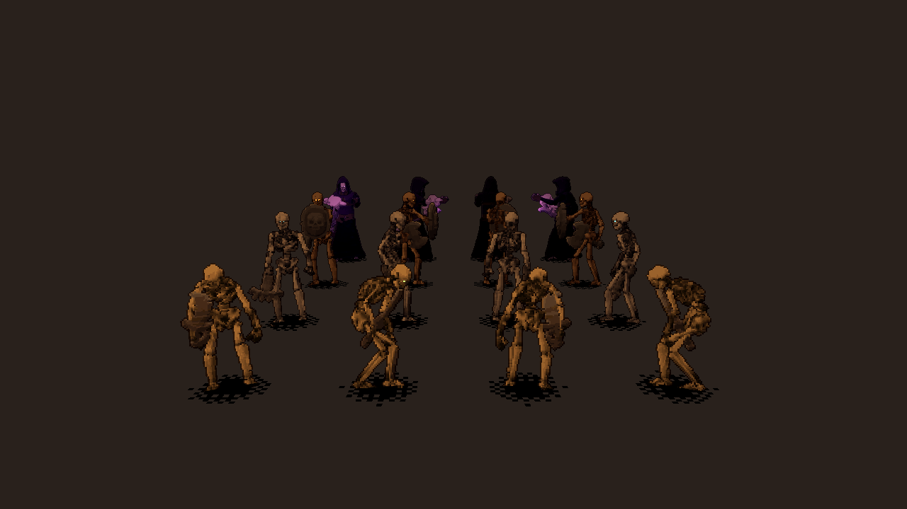

# Sprites de enemigos (pixel art estilo HD-2D)

Los enemigos se dibujan como **sprites de pixel art dentro del mundo 3D** (como en *Octopath Traveler*): un cuadro plano que siempre mira a la cámara, iluminado por las antorchas y con la misma niebla PSX del entorno. El cuadro cambia según la animación y hacia dónde mira el enemigo (de frente, de espaldas o de costado). En el juego lo hace `EnemySprite` (`scripts/world/enemy_sprite.gd`, shader `shaders/enemy_sprite.gdshader`).



**Las hojas de hoy son de prueba.** Las genera esta carpeta a partir de los modelos 3D animados que ya tenía el juego. El arte definitivo las reemplaza con el **mismo formato** (abajo) y no hace falta tocar código.

Opciones → **Enemigos** cambia entre *Pixel art* y *Modelo 3D* (se aplica desde el próximo piso). El valor por defecto está en `data/balance.json → render.enemy_style_default`.

## Formato de una hoja (para el arte definitivo)

Por especie, tres archivos en `assets/sprites/enemies/` y la ruta del JSON en `data/species.json → <especie>.visual.sprite`:

| Archivo | Qué es |
|---|---|
| `<especie>.png` | Hoja RGBA: todos los cuadros en una grilla de celdas iguales, de izquierda a derecha y de arriba abajo. Fondo transparente. El alfa se corta a 0,5 (sin semitransparencias). |
| `<especie>_glow.png` | Opcional, mismo tamaño: blanco donde el sprite **brilla** (los ojos). Esos píxeles se pintan con el color de ojos del enemigo (cambia por rango, élite o jefe), sin luz ni niebla. |
| `<especie>.json` | Cómo leer la hoja (ver abajo). |

```json
{
	"version": 1,
	"sheet": "esqueleto_esbirro.png",
	"glow": "esqueleto_esbirro_glow.png",
	"frame": [144, 144],
	"columns": 16,
	"pivot": [72, 140],
	"pixels_per_meter": 64,
	"anims": {
		"idle":   {"loop": true,  "fps": 4.5, "dirs": {"s": [0, 1, 2, 3, 4, 5], "e": [6, 7, 8, 9, 10, 11], "n": [12, 13, 14, 15, 16, 17], "w": [18, 19, 20, 21, 22, 23]}},
		"attack": {"loop": false, "fps": 5.11, "dirs": {"s": [62, 63, 64, 65, 66, 67, 68, 69]}},
		"attack_2": {"loop": false, "fps": 4.47, "dirs": {"s": [70, 71, 72, 73, 74, 75, 76, 77]}}
	}
}
```

- `frame`: tamaño de cada celda en píxeles. `columns`: celdas por fila.
- `pivot`: el punto de la celda (desde arriba a la izquierda) que va **en el piso, entre los pies**.
- `pixels_per_meter`: escala en el mundo. Con 64 (la densidad de las texturas del entorno: 128 px por celda de 2 m), un esqueleto de 1,7 m mide unos 108 px. En combate, con el preset Clásica, 1 píxel del sprite ≈ 1 píxel de la imagen de 240 líneas.
- `anims`: una entrada por **papel** de `species.json → visual.anims` (los mismos nombres). Si un papel tiene variantes (por ejemplo dos ataques), van como `attack`, `attack_2`, `attack_3`... y el juego elige una al azar.
  - `loop`: `true` en `idle`, `combat`, `walk` y `dormant`; `false` en el resto (al terminar vuelven solos a la anterior; `death` queda en su último cuadro).
  - `fps`: cuadros por segundo. La duración (cuadros / fps) importa: el combate espera a que termine el ataque o el golpe.
  - `dirs`: índices de cuadros por dirección: `s` = mira a la cámara (obligatoria), `e` = mira hacia la derecha de la pantalla, `n` = de espaldas, `w` = hacia la izquierda. Si falta `w`, se usa `e` espejado (y al revés); si falta cualquier otra, `s`. En combate el enemigo siempre está de frente: alcanza con `s` en todo salvo `idle` y `walk`, que se ven mientras deambula.

| Papel | Cuándo se ve | Direcciones |
|---|---|---|
| `idle` | Quieto, explorando | s, e, n, w |
| `walk` | Caminando (un paso = 0,2 s) | s, e, n, w |
| `combat` | En guardia durante el combate | s |
| `attack` (+ variantes) | Ataca | s |
| `hit` (+ variantes) | Recibe un golpe (además, el juego lo pone blanco un instante) | s |
| `death` | Muere (después se hunde en el piso) | s |
| `dormant` | Dormido: un montón de huesos en el piso | s |
| `spawn` | Se levanta al despertarse o al empezar el combate | s |
| `taunt`, `ability` | Solo el jefe: se burla al empezar; habilidad especial | s |

Recomendaciones de estilo: luz de arriba a la izquierda (como las de prueba), contorno oscuro de 1 px, paleta corta por especie, sin antialias. `tests/unit/test_sprites.gd` revisa que cada papel tenga su animación, que los índices estén dentro de la hoja y que haya dirección `s`. Para mirar una hoja nueva sin jugar:

```
xvfb-run -a -s "-screen 0 1280x720x24" godot --path . --rendering-driver opengl3 \
    res://tools/sprites/sprite_preview.tscn -- --out=/tmp/sprites.png [--role=walk]
```

(una fila por especie, mirando a la cámara, a la derecha, de espaldas y a la izquierda).

Después de copiar PNG nuevos: `godot --headless --path . --import` y, en los `.png.import` nuevos, `detect_3d/compress_to=0` (si no, Godot los comprime al usarlos en 3D y se ensucia el píxel).

## Cómo se generan las hojas de prueba

Dos pasos, deterministas:

```
# 1. Render de los modelos 3D animados, cuadro por cuadro (necesita display: Xvfb).
xvfb-run -a -s "-screen 0 1280x720x24" godot --path . --rendering-driver opengl3 \
    res://tools/sprites/bake_enemy_sprites.tscn -- --out=/tmp/sprites_raw [--only=nigromante]

# 2. Cuadros crudos -> pixel art: hoja + glow + JSON en assets/sprites/enemies/.
python3 -I tools/sprites/pixelize_sprites.py --raw=/tmp/sprites_raw [--only=...] [--preview=/tmp/hoja.png]
```

1. **`bake_enemy_sprites.gd`**: arma cada especie igual que en el juego (`EnemyVisual`: modelo, armas, escala) y la renderiza con cámara ortográfica a 4x el tamaño final, con materiales *toon* sobre la textura original y luz de arriba a la izquierda. Por cada papel guarda N cuadros (idle 6, walk 8, combat 6, attack 8, hit 4, death 10, spawn 12, taunt 10, ability 8, dormant 1) repartidos a lo largo del clip 3D, en las 4 direcciones para idle y walk, y una segunda pasada con todo negro salvo los ojos (la máscara de brillo).
2. **`pixelize_sprites.py`** (numpy + Pillow): reducción 4x con alfa premultiplicada (cobertura ≥ 0,35 → opaco), gradación (más contraste, sombras hacia violeta y luces hacia crema), engrosado de 1 px sin rellenar los huecos de 1 px (costillas, piernas), paleta de 16 colores por especie (k-medias en Lab) con bandas planas, píxeles sueltos fuera, luz de borde arriba/izquierda (un tono más claro de su rampa) y contorno exterior de 1 px casi negro teñido del color vecino.
