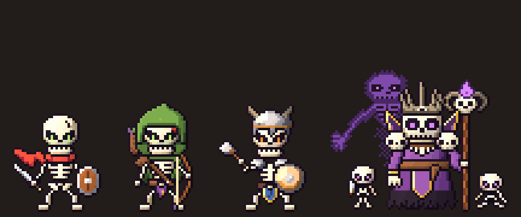
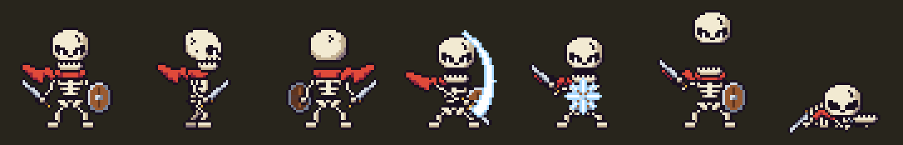

# Sprites de enemigos (pixel art de píxel gordo)

Los enemigos se dibujan como **sprites de pixel art dentro del mundo 3D**: un cuadro plano que siempre mira a la cámara, con la misma niebla PSX del entorno. El cuadro cambia según la animación y hacia dónde mira el enemigo (hasta 8 direcciones). En el juego lo hace `EnemySprite` (`scripts/world/enemy_sprite.gd`, shader `shaders/enemy_sprite.gdshader`).





Animaciones con una antorcha que da vueltas (la luz con volumen): [esbirro](../../docs/capturas/esbirro_animaciones.gif), [arquero](../../docs/capturas/arquero_animaciones.gif), [guardián](../../docs/capturas/guardian_animaciones.gif), [nigromante](../../docs/capturas/nigromante_animaciones.gif).

Las cuatro especies están en el estilo elegido, **pixel art grueso**, hechas por código (abajo) a partir de los diseños de David (el arquero y el nigromante; el guardián sigue su concepto: casco con cuernos, hacha y escudo). El arte definitivo puede reemplazarlas con el **mismo formato** sin tocar código. Opciones → **Enemigos** cambia entre *Pixel art* y *Modelo 3D* (desde el próximo piso; por defecto `data/balance.json → render.enemy_style_default`).

## Guía de estilo

Referencia: las capturas que pasó David de shooters retro con monstruos de sprite (bichos simpáticos de pocos píxeles sobre un mundo 3D) y el boceto del esqueleto con bufanda (8 vistas). La idea es un **contraste duro entre el entorno y el enemigo**: el mundo es 3D, con texturas, trama y luz; el enemigo es **pixel art grueso**, que igual tiene volumen gracias a la luz y se mueve con vida.

- **Píxeles gordos**: el sprite es chico (el esqueleto, ~38 px de alto) y se ve grande: a 24 px por metro, cada píxel del sprite mide unos 4 cm en el mundo, el triple que un texel del entorno (64 px/m). Ese salto de tamaño de píxel es el contraste.
- **Pocos colores y contorno negro**: 2–3 tonos por material (hueso claro, sombra y sombra profunda; rojo y rojo oscuro...), contorno de 1 px casi negro alrededor de cada parte. Sin degradés, sin antialias, sin tramas.
- **Simpático y con carácter**: calavera enorme (~1/3 del alto) con ceño, pupilas que brillan (máscara `glow`), nariz y una sonrisa de dientes; cuerpo chiquito de huesos de 1–2 px. Una prenda de color fuerte por especie (bufanda roja del esbirro, capucha verde del arquero, casco con cuernos y tabardo azul del guardián, túnica morada del nigromante).
- **Luz con volumen** (mapa de normales, `normal`): cada píxel del sprite sabe hacia dónde mira (la calavera es una esfera, los huesos cilindros, los bordes van biselados) y se ilumina **en bandas** según de dónde vienen las antorchas, la lámpara del equipo o la luna: luz de costado, **contraluz** en el borde, **destello** en el metal (espada, escudo) y un **reflejo de los ojos** en el hueso de alrededor. Cada píxel recibe una sola luz (nada de degradés: sigue siendo pixel art) y toma solo parte del color de la luz (`enemies.sprite_flat_tint`), así el monstruo conserva su paleta en cualquier bioma. Un poco de luz propia (`self_light`) para que se recorte en la oscuridad.
- **Lo espiritual brilla tenue**: el espectro del nigromante, la llama de su báculo, sus bolas de fuego y la onda de su grito brillan con el **color de ojos** del jefe (verde en el piso 1, rojo en el 4...) sin luz ni niebla, pero con sus propios tonos y más suave que los ojos; las auras van en trama (un píxel sí y uno no), que es la transparencia de esta paleta.
- **Animación con vida**, a lo 16 bits: todo se mueve de a píxeles enteros (nada se rota ni se escala), con **anticipación** (se agacha antes del tajo), **compresión y estiramiento** de la calavera (una fila menos o una más), **movimiento secundario** (la bufanda flamea en ida y vuelta, la cabeza llega un cuadro tarde, la mandíbula se abre al respirar y al gritar), **estela blanca** del tajo, destello del escudazo, **sacudón** al recibir un golpe (o la calavera sale volando y gira en el aire), y al morir se desarma: la calavera cae, rebota en el montón y se le apagan los ojos.

## Formato de una hoja (para el arte definitivo)

Por especie, tres archivos en `assets/sprites/enemies/` y la ruta del JSON en `data/species.json → <especie>.visual.sprite`:

| Archivo | Qué es |
|---|---|
| `<especie>.png` | Hoja RGBA: todos los cuadros en una grilla de celdas iguales, de izquierda a derecha y de arriba abajo. Fondo transparente. El alfa se corta a 0,5 (sin semitransparencias). |
| `<especie>_glow.png` | Opcional, mismo tamaño, en gris: **255** donde el sprite **brilla** a pleno (los ojos), pintado con el color de ojos del enemigo (cambia por rango, élite o jefe), sin luz ni niebla; **128** donde brilla **tenue** (lo espiritual: el espectro, una llama, un aura): su gris por el color de ojos, más suave (`spirit_energy` en el shader), también sin luz ni niebla. |
| `<especie>_normal.png` | Opcional, mismo tamaño: **mapa de normales** de cada píxel (RGB: x a la derecha, y arriba, z hacia la cámara; 0–255 = −1…1) y en el alfa el material (128 = metal, que brilla; 255 = mate). Con esto el sprite se ilumina con volumen (ver la guía de estilo). Se puede pintar a mano o sacar de herramientas de normales para sprites. |
| `<especie>.json` | Cómo leer la hoja (ver abajo). |

```json
{
	"version": 1,
	"sheet": "esqueleto_esbirro.png",
	"glow": "esqueleto_esbirro_glow.png",
	"normal": "esqueleto_esbirro_normal.png",
	"frame": [48, 53],
	"columns": 16,
	"pivot": [25, 49],
	"pixels_per_meter": 24,
	"flat_light": true,
	"self_light": 0.3,
	"anims": {
		"idle":   {"loop": true,  "fps": 5.0, "dirs": {"s": [0, 1, 2, 3, 4, 5, 6, 7], "e": [...], "n": [...]}},
		"attack": {"loop": false, "fps": 10.0, "dirs": {"s": [48, 49, 50, 51, 52, 53, 54, 55, 56]}},
		"attack_2": {"loop": false, "fps": 8.89, "dirs": {"s": [57, 58, 59, 60, 61, 62, 63, 64]}}
	}
}
```

- `frame`: tamaño de cada celda en píxeles. `columns`: celdas por fila.
- `pivot`: el punto de la celda (desde arriba a la izquierda) que va **en el piso, entre los pies**.
- `pixels_per_meter`: escala en el mundo. 64 es la densidad de las texturas del entorno (128 px por celda de 2 m); el esbirro usa 24 para que sus píxeles se vean el triple de gordos (~38 px para 1,6 m).
- `normal` (opcional): el mapa de normales (arriba). Si está, manda: luz con volumen por píxel del sprite.
- `flat_light` (opcional, `false`): sin mapa de normales, toda la hoja con la misma luz (la del centro del sprite). Sin ninguno de los dos, cada píxel lo ilumina la escena como a un HD-2D.
- `self_light` (opcional): luz propia del sprite (0–1); si falta, `data/balance.json → enemies.sprite_self_light`.
- `anims`: una entrada por **papel** de `species.json → visual.anims` (los mismos nombres). Si un papel tiene variantes (por ejemplo dos ataques), van como `attack`, `attack_2`, `attack_3`... y el juego elige una al azar.
  - `loop`: `true` en `idle`, `combat`, `walk` y `dormant`; `false` en el resto (al terminar vuelven solos a la anterior; `death` queda en su último cuadro).
  - `fps`: cuadros por segundo. La duración (cuadros / fps) importa: el combate espera a que termine el ataque o el golpe.
  - `dirs`: índices de cuadros por dirección (hacia dónde mira el enemigo respecto de la cámara): `s` de frente (obligatoria), `se` tres cuartos a la derecha de la pantalla, `e` de perfil a la derecha, `ne` de espaldas a la derecha, `n` de espaldas, y `nw`, `w`, `sw` del otro lado. El juego usa la más cercana que haya, contando las espejadas (`w` sale de `e` espejado, `sw` de `se`...): alcanza con `s`, `se`, `e`, `ne` y `n`, o incluso solo `s`, `e` y `n`. En combate el enemigo siempre está de frente: alcanza con `s` en todo salvo `idle` y `walk`, que se ven mientras deambula.

| Papel | Cuándo se ve | Direcciones |
|---|---|---|
| `idle` | Quieto, explorando | las 8 (o 5 con espejo) |
| `walk` | Caminando (un paso = 0,2 s) | las 8 (o 5 con espejo) |
| `combat` | En guardia durante el combate | s |
| `attack` (+ variantes) | Ataca | s |
| `hit` (+ variantes) | Recibe un golpe (además, el juego lo pone blanco un instante) | s |
| `death` | Muere (después se hunde en el piso) | s |
| `dormant` | Dormido: un montón de huesos en el piso (el jefe: un montón de túnica con la calavera y la corona encima, hasta su presentación) | s |
| `spawn` | Se levanta al despertarse o al empezar el combate (el jefe, en su presentación) | s |
| `taunt`, `ability` | Solo el jefe: se burla en su presentación; habilidad especial (golpea a todo el equipo) | s |

El estilo, en la guía de arriba. `tests/unit/test_sprites.gd` revisa que cada papel tenga su animación, que los índices estén dentro de la hoja y que haya dirección `s`. Para mirar una hoja nueva sin jugar:

```
xvfb-run -a -s "-screen 0 1280x720x24" godot --path . --rendering-driver opengl3 \
    res://tools/sprites/sprite_preview.tscn -- --out=/tmp/sprites.png [--role=walk]
```

(una fila por especie, mirando a la cámara, a la derecha, de espaldas y a la izquierda). Las celdas pueden tener cualquier tamaño; conviene recortarlas al rectángulo que usa la animación más ancha, como hace el generador.

Después de copiar PNG nuevos: `godot --headless --path . --import` y, en los `.png.import` nuevos, `detect_3d/compress_to=0` (si no, Godot los comprime al usarlos en 3D y se ensucia el píxel).

## Cómo se generan las hojas de prueba

```
python3 -I tools/sprites/draw_esbirro.py    [--preview=/tmp/hoja.png] [--gif=/tmp/anim.gif]
python3 -I tools/sprites/draw_arquero.py    [...]   # escribe esqueleto_picaro.*
python3 -I tools/sprites/draw_guardian.py   [...]
python3 -I tools/sprites/draw_nigromante.py [...]   # y el círculo de su sala
```

Cada script (numpy + Pillow, determinista, menos de 1 s) escribe la hoja, el brillo, el mapa de normales y el JSON de su especie; `--preview` guarda la hoja ampliada y `--gif` las animaciones iluminadas. Comparten dos módulos:

- **`pixel_kit.py`**: la paleta (`PAL`; `E` brilla a pleno, `F`/`f` brillan tenue, el metal destella), las ayudas de sellos (`art`, `flip_x`, `recolor`, `rot90`, `squash`/`stretch` de la calavera, `oriented` para un arma en 8 direcciones a partir de 3 dibujos), `Piece` (una capa con su contorno de 1 px y su forma para el mapa de normales), `Canvas` (apila las piezas y saca color, brillo y normales), las ayudas de poses (`bob`, `shift`, `lift`, `arm`, `lunge`, `jaw_open`, `pose`), la estela (`crescent`), `write_sheet` y la vista previa iluminada con la misma cuenta que el shader (`lit`, `lit_gif`).
- **`skeleton.py`**: el cuerpo de esqueleto que comparten el esbirro, el arquero y el guardián (calavera, tórax, pelvis, columna, huesos como líneas, de frente, perfil, espaldas y desarmado en el piso) y las animaciones comunes (respirar, caminar de frente y de perfil, golpe, la calavera que salta, derrumbarse y levantarse). Lo propio de cada especie lo dibuja su `Gear` en **enganches** a lo largo del orden de dibujo (`behind`, `waist`, `chest`, `left`, `right`, `head`, `fx`, los de perfil, espaldas y el montón).

Así se arma cada cuadro:

1. **Sellos dibujados a mano en ASCII** (un carácter por píxel): calavera de frente, perfil y espaldas, mandíbula, tórax, pelvis y, por especie, la bufanda y la espada del esbirro; la capucha (puesta y caída), la capa, la aljaba, la hombrera, el arco (de costado, listo y tenso) y la flecha del arquero; el casco con cuernos, las hombreras, el tabardo, el escudo de bronce y el hacha del guardián. Los huesos de brazos y piernas son **líneas de píxeles** entre hombro-codo-mano y cadera-rodilla-tobillo (con vendas a franjas en el arquero).
2. **Contorno y volumen**: cada parte lleva su borde casi negro y se apila en orden; cada parte declara su forma (`dome`, `disc`, `cyl`, `bevel`, `flat`) y de ahí sale el mapa de normales; el metal queda marcado para el destello.
3. **Poses**: un diccionario con dónde va cada parte, en píxeles enteros respecto del piso; las animaciones son listas de poses armadas con las ayudas del kit (anticipación, compresión, la cabeza que llega tarde...). La vista de espaldas es la de frente espejada con los sellos de atrás.
4. **Hoja**: idle y walk de frente (`s`), perfil (`e`; el juego espeja `w`) y espaldas (`n`); el resto de frente.

**El nigromante** (`draw_nigromante.py`) no usa el esqueleto común: es un personaje grande (~52 px hasta la corona) armado con sellos y líneas gruesas (corona de cuernos, cuello alto con ribete de oro, hombreras de calavera, collar de dientes, faja, mangas, garra y báculo retorcido con cráneo de carnero y llama), con la túnica dibujada por código (el ruedo en jirones y de alto variable: así se hunde en un montón de tela al morir y se levanta de él en su presentación). Detrás lleva un **espectro** (huesos y aura en trama, brillo tenue) y a los pies **dos esqueletitos** (uno con cuchillo) que se mueven con él: saltan, se agachan, atacan (`attack_2`), se cubren del grito y salen de la tierra en la presentación. Solo de frente: el jefe siempre mira al equipo. Sus papeles: `dormant` (el montón), `spawn` (se levanta), `taunt` (se ríe), `attack` (bola de fuego del báculo), `attack_2` (los esbirros), `ability` (el espectro grita y una onda golpea a todo el equipo), `hit`, `hit_2` (le vuela la corona), `death`. Escribe también `nigromante_circulo.png`, el círculo de runas del piso de su sala.

Para retocar un sello, editar el ASCII y volver a correr el script: no hace falta tocar nada más. Después de regenerar, si aparecieron PNG nuevos: `godot --headless --path . --import` y `detect_3d/compress_to=0` en sus `.png.import`.

Las versiones anteriores (render de los modelos 3D pasado a pixel art, commit `430558c`; formas en 2,5D, `draw_monsters.py`) quedaron en la historia del repositorio.
